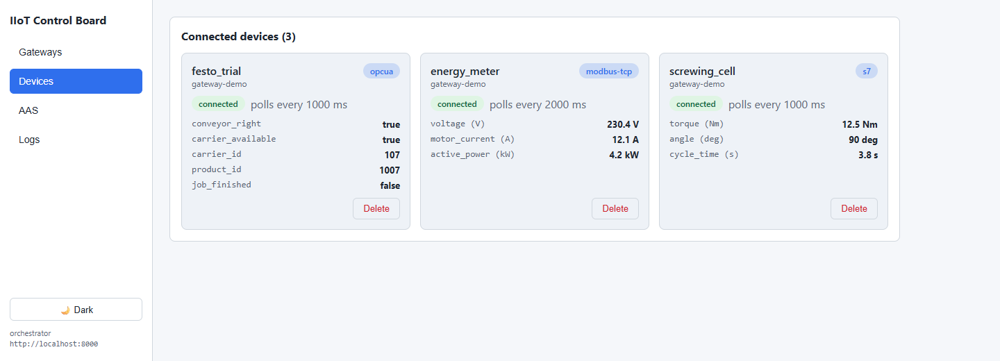
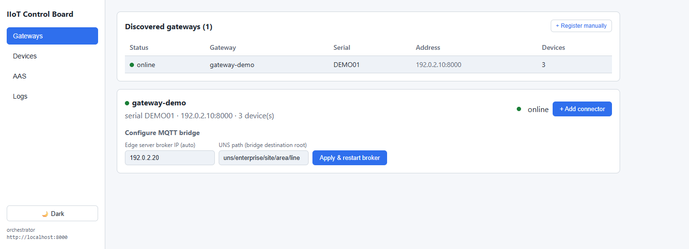
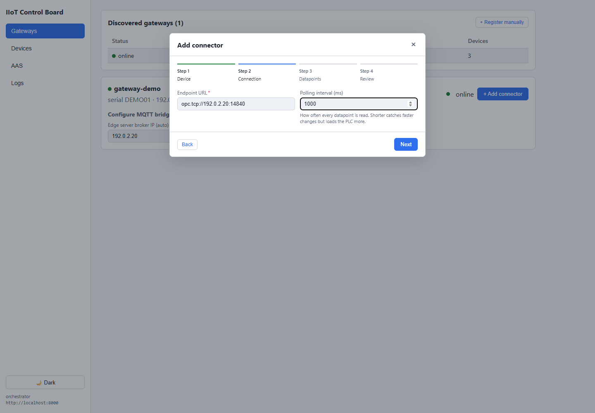
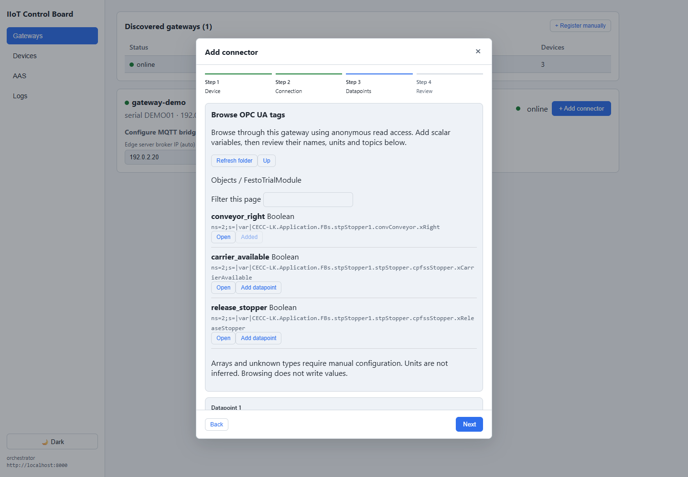
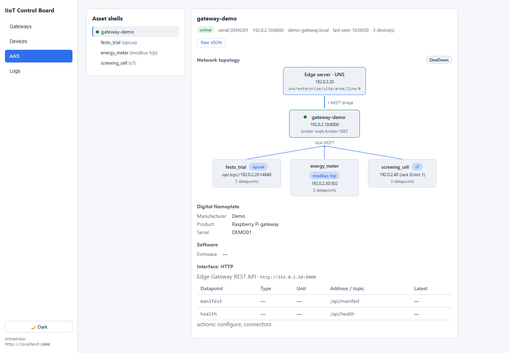
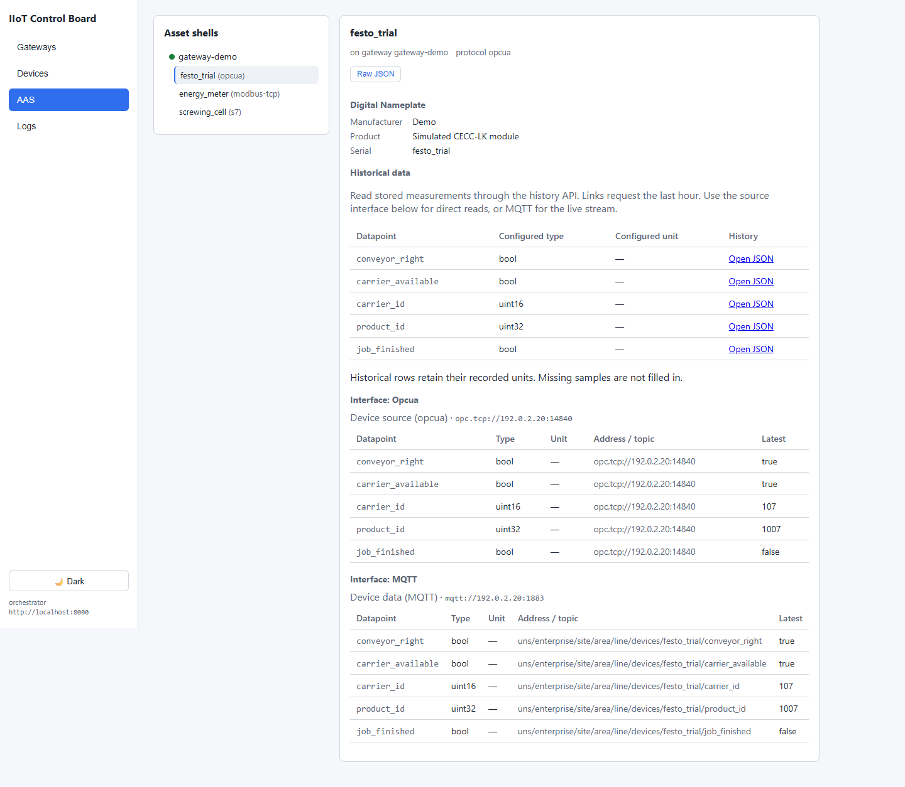
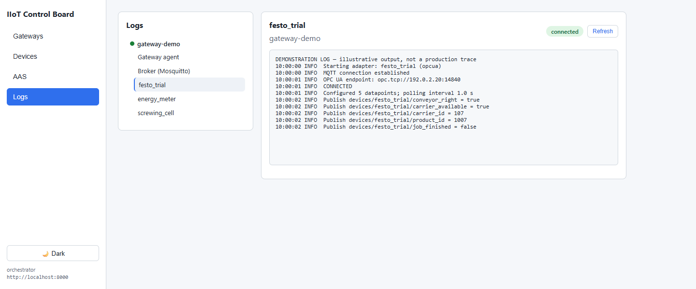

# IIoT architecture

Connect OPC UA, Modbus TCP and S7 devices through edge gateways, publish readings
over MQTT, and store them in TimescaleDB. A React dashboard handles provisioning,
OPC UA tag browsing, device status, AAS inspection and logs.

The orchestrator generates Asset Administration Shells in Eclipse BaSyx from the
connector configuration. Each device AAS describes its source interface, live MQTT
topics and historical-data API. Measurements stay in the database.

```text
Device -> adapter -> gateway MQTT -> server MQTT -> ingestor -> TimescaleDB
Gateway manifest -> orchestrator -> BaSyx AAS
                         ^
                    Web dashboard
```

## Start

Use separate gateway and server machines with Docker and Compose v2. For automatic
discovery, use hosts on the same LAN with mDNS available: a Linux gateway, and a
Linux server or a Windows server installed as described below.

From a checkout on the **server**, set its reachable addresses:

```bash
cd edge_server
export SERVER_IP=192.168.1.20  # replace with your server's LAN address
export PUBLIC_API_BASE_URL="http://${SERVER_IP}:8000"
export PUBLIC_MQTT_URL="mqtt://${SERVER_IP}:1883"
./redeploy.sh
```

From a checkout on the **gateway**:

```bash
cd edge_gateway
./redeploy.sh
```

Open `http://SERVER_IP:5173`, substituting the actual address:

1. Select the discovered gateway, or use **Register manually**.
2. Configure its MQTT bridge to the server.
3. Add a connector and its datapoints. OPC UA supports **Browse tags**.
4. Check **Devices** for connection status and readings; open **AAS** for data
   access descriptions and **Logs** for troubleshooting.

Browsing currently uses anonymous OPC UA without transport security. The management
and history APIs have no built-in authentication; use a trusted test network or
provide access control at deployment.

### Windows server

From PowerShell, with Docker Desktop, Git and Python 3.11 or later:

```powershell
irm https://raw.githubusercontent.com/AAUSmartProductionLab/iiot_architecture_LF/main/edge_server/install.ps1 | iex
```

Everything runs in Docker except the orchestrator, which runs as a Python process
in that window. Inside Docker Desktop it can neither receive mDNS nor detect the
PC's LAN address; natively, gateways are discovered without setting `SERVER_IP`.
Allow Python through Windows Firewall if prompted and keep the window open. In
`edge_server`, restart the orchestrator with
`powershell -ExecutionPolicy Bypass -File run-orchestrator.ps1`, or rebuild everything
with `redeploy.ps1`. If a VPN changes the detected address, set `$env:SERVER_IP`
first. To stop, press Ctrl+C in that window and run `docker compose down`.

### Docker Desktop only

Without the native orchestrator, use bridge networking and manual gateway
registration. In a Bash shell, run `USE_HOST_NET=0 ./redeploy.sh`. From PowerShell,
run the equivalent Compose commands in each role's directory:

```powershell
# Server
$env:SERVER_IP = '192.168.1.20'
$env:PUBLIC_API_BASE_URL = "http://${env:SERVER_IP}:8000"
$env:PUBLIC_MQTT_URL = "mqtt://${env:SERVER_IP}:1883"
docker compose up -d --build
# Gateway (on the other machine)
docker compose --profile build build
docker compose up -d
```

| Service | Port |
| --- | --- |
| Dashboard / orchestrator | 5173 / 8000 |
| BaSyx API / AAS viewer | 8081 / 8082 |
| MQTT / TimescaleDB | 1883 / 5432 |

To stop either Linux stack, run
`docker compose -f docker-compose.yaml -f docker-compose.host.yml down` in its
directory. Omit the host override for bridge networking. Data volumes are preserved.

## Test and explore

- [Festo simulator and Node-RED reference](tests/simulators/FESTO.md)
- [Automated tests](tests/README.md) and [data verification](tests/evaluation/README.md)
- [External history client example](examples/read_device_history.py)

Device AASs expose history links under **Historical data**. Open a link to read
the last hour of stored readings, or use the example client with a device AAS ID.

## Dashboard

Real UI captures with demonstration data:



 |
 |
 |
 |
 |

